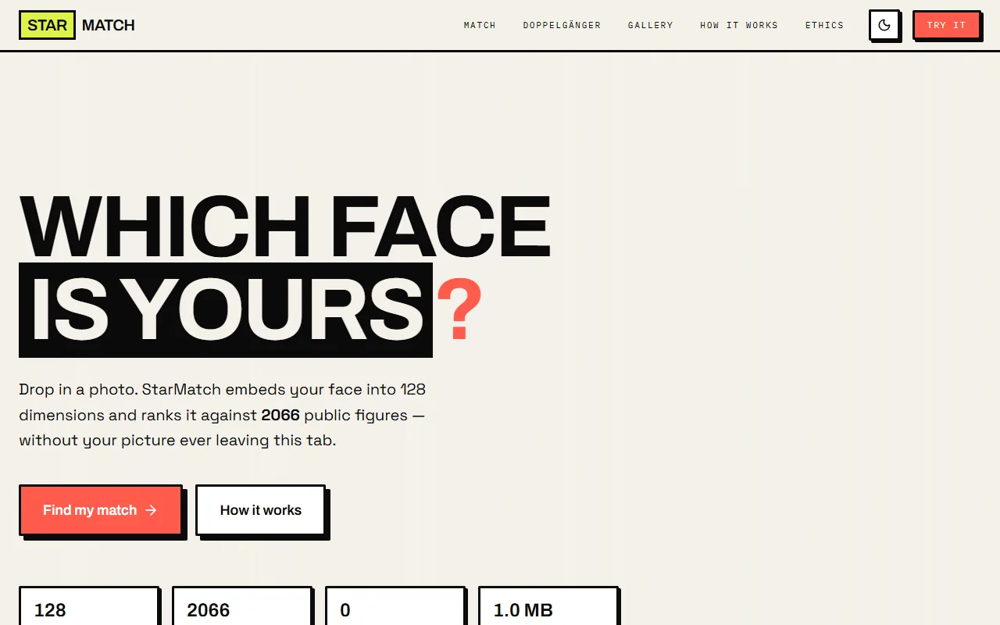
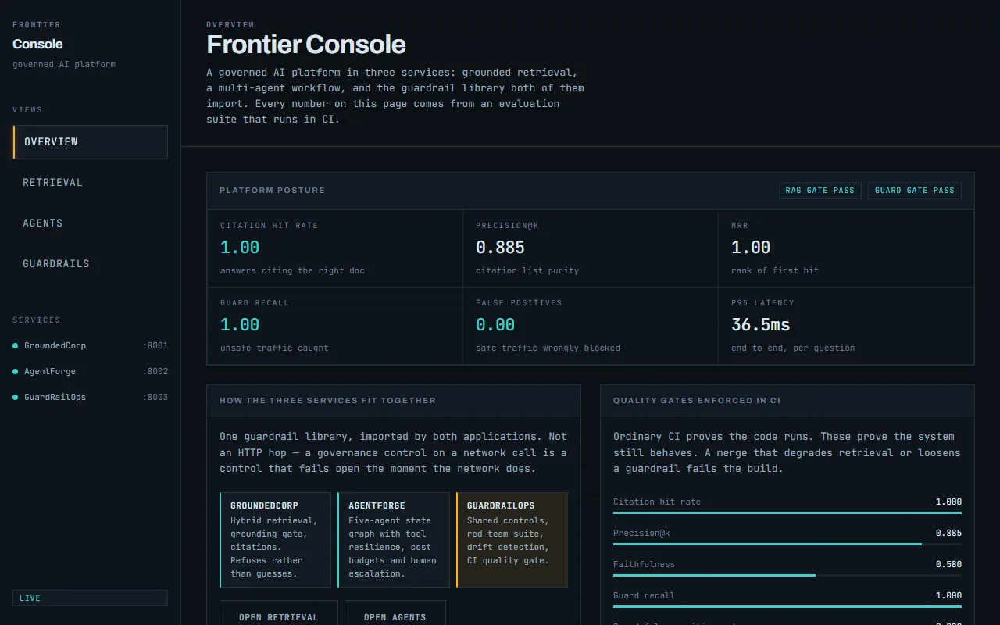
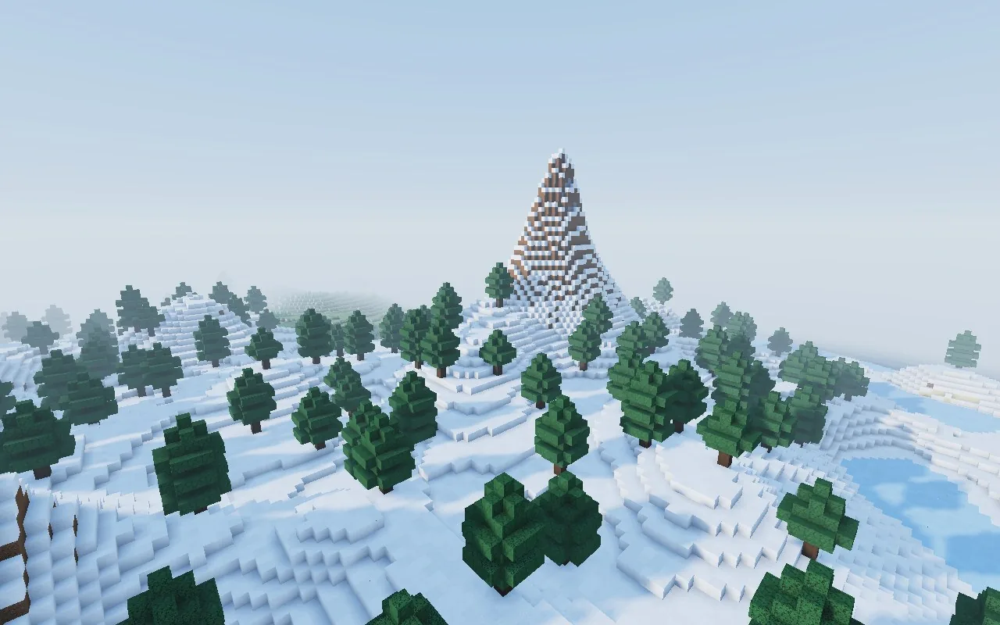
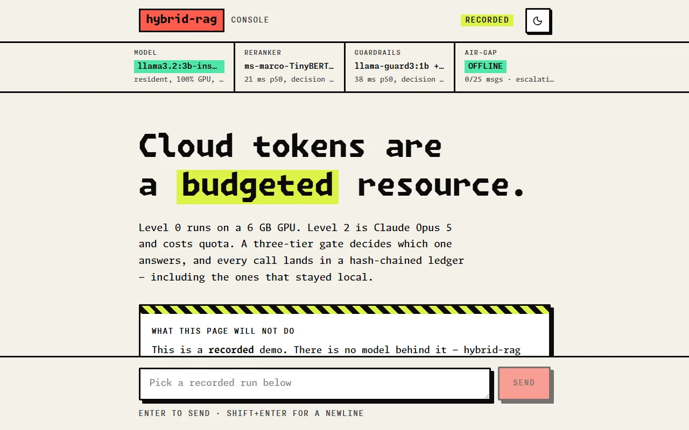

<table width="100%">
  <tr>
    <td valign="middle">
      <a href="https://x.com/KevinJo65718435" title="X"><picture><source media="(prefers-color-scheme: dark)" srcset="https://cdn.simpleicons.org/x/ffffff"></picture></a>
      
      <a href="https://portfolio-kjs-47.vercel.app" title="Portfolio"><picture><source media="(prefers-color-scheme: dark)" srcset="assets/globe-dark.svg"></picture></a> <b>Hey! Nice&nbsp;to&nbsp;meet&nbsp;you&nbsp;👋</b>
    </td>
  </tr>
  <tr>
    <td align="center">
      
      
       
      
      
    </td>
  </tr>
  <tr>
    <td>
      <b>languages</b> 
      
      
      
      
      
      
    </td>
  </tr>
  <tr>
    <td>
      <b>frontend</b> 
      
      
      
      
      
      
      
    </td>
  </tr>
  <tr>
    <td>
      <b>agents / ai</b> 
      
      
      
      
      
      
    </td>
  </tr>
  <tr>
    <td>
      <b>infra</b> 
      
      
      
      
      
      
      
      
    </td>
  </tr>
</table>

<b>recent activity</b>

 

<!--START_SECTION:activity-->
1. 💪 Opened PR [#1](https://github.com/JamesKevinJones/evalbench/pull/1) in [JamesKevinJones/evalbench](https://github.com/JamesKevinJones/evalbench)
2. 💪 Opened PR [#1](https://github.com/JamesKevinJones/starmatch/pull/1) in [JamesKevinJones/starmatch](https://github.com/JamesKevinJones/starmatch)
3. 💪 Opened PR [#2](https://github.com/JamesKevinJones/seatflow/pull/2) in [JamesKevinJones/seatflow](https://github.com/JamesKevinJones/seatflow)
4. 💪 Opened PR [#2](https://github.com/JamesKevinJones/tiny-gpt/pull/2) in [JamesKevinJones/tiny-gpt](https://github.com/JamesKevinJones/tiny-gpt)
<!--END_SECTION:activity-->

